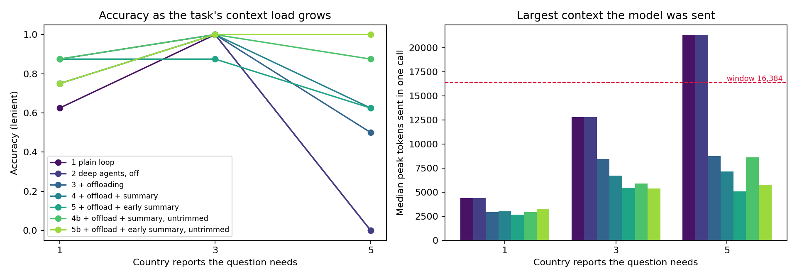
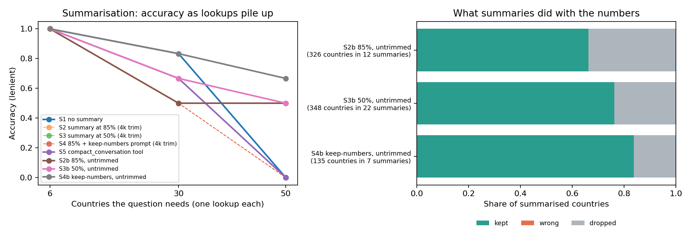

[Code and data on GitHub](https://github.com/CJosh88/ML/tree/main/experiments/2026-10-deep-agents-context-rot)

::: {.callout-note appearance="simple"}
## TL;DR

- **Overflow fails silently.** With `qwen3.5:4b` and a 16k window, once the context overflowed, a plain tool-calling loop got every answer wrong. Ollama dropped part of the conversation and nothing in the output said so.
- **Offloading is the cheap, safe fix.** Deep Agents' offloading moved big tool results into files, kept the context around 5–9k tokens and recovered about half of those questions.
- **Summarisation works, but only with three non-default settings:** a trigger sized for the window, a real token counter, and no trim on the history it reads. With the summariser constructor's default trim, it silently replaced the history with "Previous conversation was too long to summarize." without calling the model.
- **Summaries never stated a wrong number, but they dropped some.** They lost 16–34% of the values they had to carry forward, and one extra instruction in the summary prompt roughly halved that.
- **The model never managed its own context.** Given a `compact_conversation` tool and a nudge to use it, it called the tool 0 times in 18 runs.
:::

## The question

Agents rarely fail on long tasks because the model is weak. More often, the context fills with tool output and history until the important parts are lost. LangChain calls this *context rot*, and on 14 October 2026 it described how its open-source harness, [Deep Agents](https://github.com/langchain-ai/deepagents), fights it: [Context Engineering: How Deep Agents Remember](https://blog.langchain.com/context-engineering-deep-agents-remember).

Small local models have short context windows, so they're where this should matter most. I tested the two techniques that act inside a single run:

- **Offloading:** a large tool result is written to a file, and the model sees a preview plus tools to read the file.
- **Summarisation:** once the conversation passes a threshold, older messages are replaced by a model-written summary.

For each, I asked how much it keeps a small local agent accurate when its tool outputs overflow the window, compared with a plain tool-calling loop.

## Setup

| | |
|---|---|
| **Model** | `qwen3.5:4b` through Ollama 0.40.4 on a free Colab T4, with a 16,384-token window and greedy decoding |
| **Libraries** | deepagents 0.7.25, langchain 1.4.6, langgraph 1.2.15, langchain-ollama 1.1.0 |
| **Data** | [Our World in Data CO₂ and greenhouse gas emissions](https://github.com/owid/co2-data) (CC BY 4.0), pinned to one commit: 59 countries with complete 2004–2023 data and at least 10 million people |
| **Questions** | Generated with gold answers computed in pandas from the same rounded values the agent sees, e.g. "Of these countries, which had the largest increase in coal CO₂ between 2007 and 2012, and by how much?" |
| **Scoring** | Correct if the reply's last line names the right country or year and the right number (within 1%). A stricter score that also requires an `ANSWER:` line is in the notebook. |

Every arm uses the same model, tools, system prompt and questions. Only the context handling changes.

**Deep Agents' defaults wouldn't fire here, so I set the thresholds myself.** Offloading starts at about 20,000 tokens by default. Summarisation starts at 170,000 tokens for any model that doesn't report its context size, which includes every Ollama model. I offloaded tool results over 4,000 characters and summarised at 85% or 50% of the window, counting tokens with Qwen's own tokenizer. Deep Agents' built-in estimate (4 characters per token) undercounts these number-heavy results by about 2.4×, so the trigger would fire too late.

## Summarisation's silent fallback

To set the trigger and token counter, I built Deep Agents' `SummarizationMiddleware` myself and passed it in, which is the documented way to replace the built-in one. Its constructor has one more default, `trim_tokens_to_summarize=4000`: the summary model may read only the last 4,000 tokens of the history it replaces.

LangChain trims that history from the start, and the trimmed part has to begin with a user message. In a one-question agent run, the only user message is the question at the top. So whenever the history to summarise was longer than 4,000 tokens, which was almost always, the trim left nothing. The middleware then skipped the model call and used the fixed text *"Previous conversation was too long to summarize."* as the summary. The agent lost everything it had looked up. No error or warning was raised, and because no model was called, my logs first suggested the summariser had never fired.

`create_deep_agent`'s own summariser passes no trim, so Deep Agents' defaults don't do this. You only hit it by building the middleware yourself, which is also the only way to change the trigger. I kept the trimmed arms in the results as a record of the pitfall, and added "untrimmed" arms that let the summariser read the whole history.

## Part 1: big tool results

A tool, `get_country_report(country)`, returns one country's 2004–2023 values for 12 emissions and energy metrics, about 4,000 tokens each. There are 24 questions, 8 each that need 1, 3 or 5 reports. Five reports (about 21k tokens) can't fit in the window.

| Arm | Correct (of 24) | 5 reports (of 8) | Runs over the window | Peak context (median) | Summaries written | Silent fallbacks | Median time |
|---|---|---|---|---|---|---|---|
| 1 Plain loop (`create_agent`) | 13 | 0 | 8 | 12.8k | – | – | 16 s |
| 2 Deep Agents, both off | 15 | 0 | 8 | 12.8k | – | – | 17 s |
| 3 + Offloading | 18 | 4 | 0 | 5.3k | – | – | 27 s |
| 4 + Summary at 85%, 4k trim | 19 | 5 | 0 | 4.7k | 0 | 3 | 25 s |
| 5 + Summary at 50%, 4k trim | 19 | 5 | 0 | 4.2k | 4 | 4 | 23 s |
| 4b + Summary at 85%, untrimmed | 22 | 7 | 0 | 4.7k | 2 | 0 | 21 s |
| 5b + Summary at 50%, untrimmed | 22 | 8 | 0 | 4.7k | 10 | 0 | 25 s |

Arms 3–5b all include offloading. Peak context is the largest number of tokens sent in one model call.

- **The plain loop breaks exactly where the window does.** It got 13 of 16 questions with 1 or 3 reports and 0 of 8 with 5. Those are the runs that went over the window. Ollama silently drops part of the conversation, and the model answers without the data or the question.
- **Offloading alone took accuracy from 13 to 18, and the 5-report questions from 0 to 4.** The context stayed around 5–9k tokens. The model really used the files, with about 3.7 `read_file` and 2.3 `grep` calls per question, rather than guessing from the preview.
- **Whether summarisation helped on top is hard to say from Part 1.** The untrimmed arms scored 22, but 4b summarised on only 2 of 24 questions. On the other 22 it sent the model the same thing as arm 3 and still scored 20 against 17. That gap is run-to-run noise, partly because the untrimmed arms ran in a later session. The cleanest signal is 5b: on the 8 questions where it summarised, it got 7 right, against 4 for offloading alone. That's suggestive, not conclusive.
- **Some of the cost is format.** With offloading, the model often gave the right answer in prose and dropped the `ANSWER:` line (10 of arm 3's 24 replies). Strict scoring would make the Deep Agents arms look much worse than they are.

## Part 2: many small results

Part 1 couldn't really test summarisation, because offloading kept the context small. So Part 2 makes the context grow from many small results that are never offloaded:

- **Tool:** `get_series(country, metric)` returns one country's 2004–2023 values for one metric, about 370 tokens.
- **Questions:** 18 questions on 6, 30 or 50 countries (6 each), so about 2k, 11k and 18k tokens of lookups. That's below both triggers, between them, and over the window.

| Arm | Correct (of 18) | 50 countries (of 6) | Summaries written | Silent fallbacks | Values dropped by summaries | Median time |
|---|---|---|---|---|---|---|
| S1 No summarisation | 11 | 0 | – | – | – | 49 s |
| S2 Summary at 85%, 4k trim | 9 | 0 | 2 | 5 | – | 47 s |
| S3 Summary at 50%, 4k trim | 10 | 0 | 6 | 6 | – | 34 s |
| S4 85% + keep-numbers prompt, 4k trim | 9 | 0 | 2 | 5 | – | 47 s |
| S5 `compact_conversation` tool | 10 | 0 | 0 | – | – | 50 s |
| S2b Summary at 85%, untrimmed | 12 | 3 | 12 | 0 | 34% | 52 s |
| S3b Summary at 50%, untrimmed | 13 | 3 | 22 | 0 | 24% | 54 s |
| S4b 85% + keep-numbers prompt, untrimmed | 15 | 4 | 7 | 0 | 16% | 51 s |

The keep-numbers prompt is Deep Agents' default summary prompt plus one instruction: list every value looked up so far, verbatim, as `country | metric | year | value`.

- **Without working summarisation, 50 countries failed every time.** S1 went over the window in 4 of 6 runs and gave up partway through the lookups in the rest.
- **The trimmed arms never summarised a lookup.** Their "summaries" either covered only the question or were the fallback text, so their 50-country accuracy stayed at 0.
- **The model never used `compact_conversation`.** In S5, automatic summarisation was off and the model could compact on demand with Deep Agents' compaction tool, with a system-prompt line telling it the tool exists and when to use it. It called the tool 0 times in 18 runs.
- **Untrimmed, summarisation works.** On 50 countries, S2b and S3b got 3 of 6 and S4b 4 of 6. The cleanest comparison is the questions where a summary actually happened: S1 got 0–1 of those right, against S2b's 3 of 4, S3b's 4 of 6 and S4b's 5 of 5. Where no summary happened, the arms were roughly level with S1, as you'd expect.
- **Summarising earlier (50%) summarised more and dropped less** than at 85%: 22 summaries against 12, 24% of values dropped against 34%, with similar accuracy (13 vs 12). The direction is consistent, but each comparison rests on 4–6 summarised questions.

### What the summaries did with the numbers

For every summary, I checked each country the question needed whose lookup the summary replaced: did the summary keep a needed value, state a different number, or drop the country? A later summary is held to every lookup before it, so it has to carry forward what earlier summaries kept.

| Arm | Countries checked | Kept | Wrong | Dropped |
|---|---|---|---|---|
| S2b, default prompt, 85% | 326 (12 summaries) | 66% | 0% | 34% |
| S3b, default prompt, 50% | 348 (22 summaries) | 76% | 0% | 24% |
| S4b, keep-numbers prompt, 85% | 135 (7 summaries) | 84% | 0% | 16% |

- **Summaries fail by leaving things out, not by making things up.** Not one stated a wrong number. Most dropped countries weren't mentioned at all.
- **One instruction in the prompt roughly halved the losses**, from 34% to 16% at the same trigger. LangChain's post recommends customising the summary prompt, and for exact values that's a cheap win.
- **Dropped values cost time and accuracy.** At 50 countries, S2b made about 70 lookups per question for 50 countries, because the model re-fetched values its summary had lost. Sometimes that rescued the answer.

## What I take from this

1. **With a small local model, the window is the hard limit, and overflow is silent.** Every arm that let the context grow past 16k scored 0 at the hardest level, and nothing in the output said why. You need something that keeps the context under the window, and a check that it did.
2. **Offloading is the default worth having.** It's cheap, it never loses data, and the agent can read the full result back. Use it when single tool results are big.
3. **Summarisation is a power tool that fails quietly.** It made 50-country questions partly solvable, but only with an explicit trigger, a real token counter, no trim, and ideally a prompt that tells it to keep the numbers. None of the settings that broke it raised an error. Measure whether it actually ran.
4. **Don't rely on a 4B model to manage its own memory.** At this size, context management has to be automatic.
5. **Out of the box, Deep Agents is tuned for frontier models.** On a 16k window, neither technique would fire at its default threshold. It's worth using with a small local model, but only with the thresholds set for that model's window.

## Limitations

- **Small samples, one run per arm.** 24 questions in Part 1 and 18 in Part 2. Ollama isn't fully deterministic even at temperature 0, and arms that sent the model identical inputs disagreed on 2–3 questions, so treat gaps that size as noise.
- **The untrimmed arms ran in a later session** than the arms they're compared with.
- **One model, one window size.** Results for `qwen3.5:4b` at 16k may not transfer to larger models or longer windows; both are config changes in the notebook.
- **A synthetic task.** The questions need exact numbers from one dataset. That suits offloading, which keeps the raw data, more than summarisation, which can paraphrase it away.
- **The fidelity check is a heuristic.** It looks for a needed value written right after the country's name, so a country written another way (such as "UAE") counts as dropped. Which history a summary replaced, and which compactions were fallbacks, are worked out from the message counts in the saved traces.
- **Batched lookups can't be summarised.** The model often requested all 30 or 50 series in one reply. Deep Agents never separates a tool request from its results, so a batch like that can't be compacted at all.
- **Not tested:** skills, long-term memory and the researcher-subagent arm (in the notebook, off by default).

## Data and reproducibility

| Dataset | Source | Licence |
|---|---|---|
| CO₂ and Greenhouse Gas Emissions | [Our World in Data](https://github.com/owid/co2-data), commit [`382ee6c`](https://github.com/owid/co2-data/tree/382ee6c662b0ece26e111f263b44c029afad7787) | CC BY 4.0 |

The notebook runs top to bottom on a free Colab T4 with the [Open in Colab](https://colab.research.google.com/github/CJosh88/ML/blob/main/experiments/2026-10-deep-agents-context-rot/notebook.ipynb) button, with pinned versions. No API keys are needed. It caches every run and trace to Google Drive, so a disconnect resumes where it stopped. Per-question results, summary tables and figures are [on GitHub](https://github.com/CJosh88/ML/tree/main/experiments/2026-10-deep-agents-context-rot).
