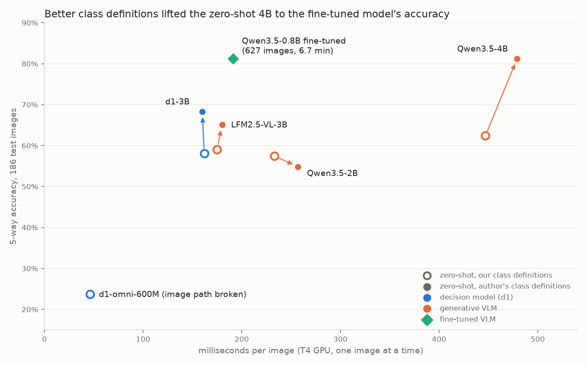
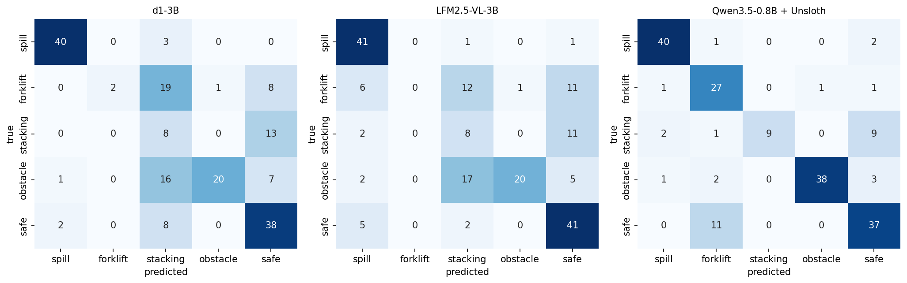
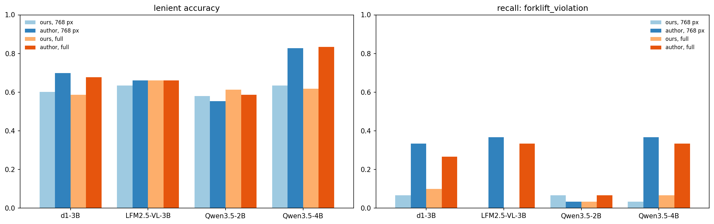
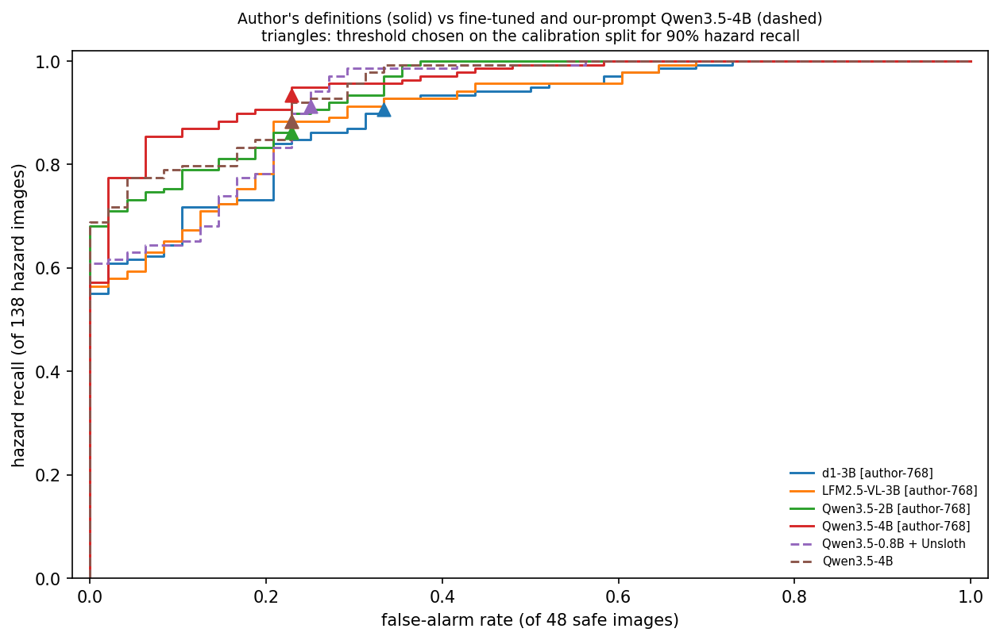
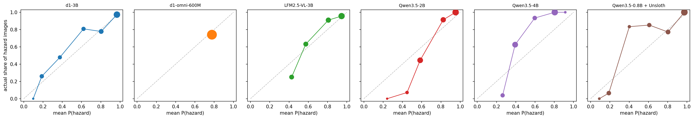
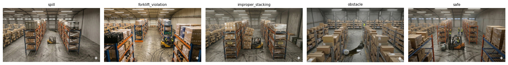

[Code and data on GitHub](https://github.com/CJosh88/ML/tree/main/experiments/2026-10-warehouse-hazards-d1-vlm)

::: {.callout-warning appearance="simple"}
## The images are synthetic

Every image in this benchmark is a Blender render of a warehouse, made photorealistic and given its hazard by Google Gemini. The results compare models on this benchmark. They don't show how any of these models would do on real camera footage.
:::

::: {.callout-note appearance="simple"}
## TL;DR

- **How you describe the classes mattered as much as fine-tuning.** With the dataset author's more specific class definitions, a zero-shot Qwen3.5-4B went from 62% to 81% accuracy (p < 0.001). That's level with a Qwen3.5-0.8B fine-tuned on 627 images in 6.7 minutes (81%, p = 1.0).
- **The two get there differently.** The fine-tuned model names forklift violations correctly (27 of 30), runs 2.5× faster and needs a third of the GPU memory. The prompted 4B raises fewer false alarms and catches more stacking problems.
- **d1's decision post-training didn't beat its own base model on accuracy**, under either prompt. What it did deliver is honest confidence out of the box, which one temperature fitted on 100 labelled images also gave the base model.
- **For "send someone to look", the threshold matters more than the model.** With thresholds chosen on held-out data, the prompted 4B, the fine-tuned 0.8B and the prompted d1-3B all caught 125–129 of 138 hazards with 11–16 false alarms on 48 safe images.
- **The zero-shot models don't miss forklift violations; they mislabel them.** The prompted 4B named only 11 of 30 correctly but flagged 26 of 30 as hazards.
:::

## The question

LiquidAI's **[d1](https://huggingface.co/blog/LiquidAI/open-d1)** models (released 7 October 2026) are "system-1" decision models. They take an image and a typed question, and return a probability for every answer in one forward pass, without generating text. d1-3B was post-trained from LiquidAI's own vision-language model, LFM2.5-VL-3B.

Visual inspection is one of the most common business uses for vision models: safety audits, compliance checks and insurance photos. So I wanted to know, for spotting safety hazards in warehouse images:

1. Does d1's decision post-training beat its own base model, and other small VLMs, used off the shelf?
2. How does that compare with fine-tuning a small VLM on a few hundred labelled images?
3. For the business question "does this image need a person to look at it?", how many hazards does each option miss, and how many false alarms does it raise?

## How every model answers

Every model gets the same 5-way question about the same images, resized to at most 768 px.

- **The d1 models** answer natively. A `choice` question lists the five classes with a description each, and d1 returns a probability per class.
- **The generative VLMs** see the same classes as options A–E. Instead of parsing generated text, I read their next-token probabilities for the five letters, which gives a probability per class from one forward pass. As a check, on 30 images each model also wrote its answer, and it matched the top letter every time.
- **The fine-tuned model** is Qwen3.5-0.8B trained with Unsloth to answer the same A–E prompt with the right letter, and scored the same way. Unsloth 2026.10.3's decision-model trainer doesn't train on images yet, so this is a standard vision LoRA fine-tune, not a decision head.

So the comparison is purpose-built decision models against ordinary VLMs used as classifiers. The models' probabilities don't come equally calibrated: d1 ships with fitted temperatures, and the others don't. So every model gets one temperature fitted on 100 held-out labelled images before thresholds are chosen. That changes how confident a model is, but never which class it picks, so accuracy is unaffected.

## Setup

| | |
|---|---|
| **Data** | [`Jsohal174/warehouse-safety-hazard-dataset`](https://huggingface.co/datasets/Jsohal174/warehouse-safety-hazard-dataset) (CC BY 4.0): 913 overhead warehouse images in 5 classes (spill, forklift violation, improper stacking, obstacle, safe) |
| **Splits** | The official 186-image test set (138 hazard, 48 safe). From the 727 training images: 100 held out for calibration and thresholds (stratified, seed 42) and 627 for fine-tuning. |
| **Decision models (zero-shot)** | d1-3B, d1-omni-600M |
| **Generative VLMs (zero-shot)** | LFM2.5-VL-3B (d1-3B's base), Qwen3.5-2B, Qwen3.5-4B |
| **Fine-tuned** | Qwen3.5-0.8B, vision LoRA (r = 16, 2 epochs) with Unsloth 2026.10.3: 6.7 minutes, 3.5 GB peak GPU memory |
| **Hardware** | One free Colab T4 |

The notebook also includes Claude Opus 5.5 as an optional paid ceiling. It wasn't run for this post, so there's no frontier comparison here.

## Results with our class definitions

| Model | Accuracy | 95% CI | Hazards caught (P ≥ 0.5) | False alarms | Forklift recall | ECE as shipped → after fit | ms / image | GPU memory |
|---|---|---|---|---|---|---|---|---|
| **Qwen3.5-0.8B fine-tuned** | **81.2%** | 75.0–86.1% | 126 / 138 | 12 / 48 | **90%** | **0.032** → 0.025 | 191 | **3.1 GB** |
| Qwen3.5-4B | 62.4% | 55.2–69.0% | 102 / 138 | **2 / 48** | 3% | 0.229 → 0.095 | 447 | 9.9 GB |
| LFM2.5-VL-3B | 59.1% | 52.0–66.0% | 129 / 138 | 21 / 48 | 0% | 0.276 → 0.062 | 175 | 6.9 GB |
| d1-3B | 58.1% | 50.9–64.9% | 120 / 138 | 15 / 48 | 7% | 0.074 → 0.070 | 162 | 6.8 GB |
| Qwen3.5-2B | 57.5% | 50.3–64.4% | 137 / 138 | 34 / 48 | 7% | 0.137 → 0.106 | 233 | 5.2 GB |
| d1-omni-600M | 23.7% | 18.1–30.3% | 138 / 138 | 48 / 48 | 3% | 0.385 → 0.008 | 46 | 1.7 GB |

ECE (expected calibration error) measures how far a model's confidence is from how often it's right; lower is better. The "after fit" column is after the temperature fitted on the calibration images.

With these definitions, fine-tuning looks dominant: the 0.8B model beat every zero-shot model, including Qwen3.5-4B (49 images only the fine-tune got right against 14 the other way, p < 0.001). And no zero-shot model recognised forklift violations: their recall was 0–7%.

**d1-3B and its own base made almost identical predictions.** They disagreed on only 14 of 186 images (6 vs 8 right, p = 0.79). The visible difference is calibration. As shipped, d1-3B's confidence was honest (fitted temperature 0.97), while LFM2.5-VL-3B's was badly overconfident (temperature 3.5). But one temperature fitted on 100 images brought LFM2.5-VL-3B level.

**d1-omni-600M's image path looks broken.** It almost never predicted "spill" (mean probability 0.001), and after calibration it flagged every image. Its model card calls it an early research release, so I report it but don't draw conclusions from it.

## The prompt check

My zero-shot Qwen scores were well below the dataset card's: 57.5% and 62.4% against 67.2% and 83.3%. The author's [benchmark script](https://github.com/Jsohal174/safety-hazard-detection) showed why. Their class definitions name the visual cues the hazards actually contain:

| Class | Our definition | The author's definition |
|---|---|---|
| forklift violation | Unsafe forklift operation (overloading, tipping or speeding) | unsafe forklift operation (raised forks, no seatbelt, pedestrian too close, improper load) |
| improper stacking | Unstable or incorrectly stacked pallets or boxes | boxes on shelves are tilted, overhanging, crushed, torn wrap, unstable |
| obstacle | Debris, equipment or objects blocking an aisle | objects blocking the aisle floor (fallen boxes, debris, abandoned equipment, broken pallets) |

I reran the zero-shot models with the author's definitions, at both 768 px and full resolution, with the same letter scoring.

| Model | Ours, 768 px | Author's, 768 px | Ours, full | Author's, full |
|---|---|---|---|---|
| Qwen3.5-4B | 63.4% | **82.8%** | 61.8% | **83.3%** |
| d1-3B | 60.2% | 69.9% | 58.6% | 67.7% |
| LFM2.5-VL-3B | 63.4% | 66.1% | 66.1% | 66.1% |
| Qwen3.5-2B | 58.1% | 55.4% | 61.3% | 58.6% |

This table uses lenient accuracy (counting the dataset's alternative acceptable labels), the dataset card's metric.

- **The definitions explain the gap for Qwen3.5-4B.** With the author's wording it scores 82.8–83.3%, matching the card's 83.3%. Against our wording, 38 images became right and 3 became wrong (p < 0.001).
- **Resolution didn't matter.** Full resolution changed nothing significant (Qwen3.5-4B: 3 vs 5 images, p = 0.73) and made every model 2–3× slower.
- **Qwen3.5-2B didn't benefit** and stays 5–10 points below the card. The remaining differences in the author's setup (free-text answers parsed with a keyword fallback, and 4-bit models through Ollama) weren't tested.
- **d1-3B gained 10 points but caught fewer hazards.** Its accuracy rose from 58.1% to 68.3% (p = 0.004), mostly by calling more images safe. Counting a hazard as caught when the top class isn't "safe", it caught 84 of 138, down from 110, and missed every stacking problem: 20 of the 21 stacking images became "safe". With the same prompt it still didn't beat its base (68.3% vs 65.1%, p = 0.18).

### A well-prompted 4B against the fine-tune

With the author's definitions, Qwen3.5-4B reaches 81.2% strict accuracy, the same as the fine-tuned 0.8B. They split the disagreements exactly: 21 images only one got right, 21 only the other (p = 1.0). They get there differently:

| | Fine-tuned Qwen3.5-0.8B | Qwen3.5-4B, author's definitions |
|---|---|---|
| Hazards caught (top class isn't "safe") | **123 / 138** | 114 / 138 |
| False alarms | 11 / 48 | **3 / 48** |
| Forklift violations named correctly | **27 / 30** | 11 / 30 |
| Stacking problems named correctly | 9 / 21 | **16 / 21** |
| Speed / GPU memory | **191 ms, 3.1 GB** | 479 ms, 9.9 GB |

## "Needs attention": hazards caught vs false alarms

In practice you'd flag an image for a person to check when P(hazard) passes a threshold. The rule was fixed in advance: for each model, take the highest threshold that catches at least 90% of the hazard images in the 100-image calibration split (about 70 hazards), then apply it unchanged to the test set. The test set plays no part in the choice.

| Model | Hazards caught | False alarms | Precision |
|---|---|---|---|
| **Qwen3.5-4B, author's definitions** | **129 / 138** | **11 / 48** | 92% |
| Qwen3.5-0.8B fine-tuned | 126 / 138 | 12 / 48 | 91% |
| d1-3B, author's definitions | 125 / 138 | 16 / 48 | 89% |
| LFM2.5-VL-3B, author's definitions | 122 / 138 | 11 / 48 | 92% |
| Qwen3.5-4B, our definitions | 122 / 138 | 11 / 48 | 92% |
| d1-3B, our definitions | 122 / 138 | 16 / 48 | 88% |
| Qwen3.5-2B, author's definitions | 119 / 138 | 11 / 48 | 92% |

- **The best models are level.** The prompted 4B flagged 7 hazard images the fine-tune missed, and the fine-tune flagged 4 the 4B missed (p = 0.55). Five hazards slipped past both: 2 spills, 2 stacking problems and 1 obstacle.
- **Forklift violations get flagged even when they're mislabelled.** The prompted 4B named only 11 of 30 correctly but flagged 26 of 30 as hazards, and the prompted d1-3B flagged all 30. The zero-shot models see that something is wrong but call it the wrong kind of hazard. That matters if the class decides who gets alerted, and much less if the job is "send someone to look".
- **The default threshold can be badly placed.** At P ≥ 0.5, the prompted d1-3B caught only 91 of 138 hazards. Its calibration-chosen threshold, 0.20, lifted that to 125. The fine-tuned model was already well placed, at 126 either way.

## What I take from this

1. **Write good class definitions before you fine-tune.** Naming the visual cues ("raised forks, pedestrian too close") took a zero-shot 4B from 62% to 81%. It cost nothing and needed no labelled data beyond what's needed to check it.
2. **Fine-tuning still earned its place, for different reasons than I expected.** It didn't beat a well-prompted larger model on accuracy. It named the hazards correctly where zero-shot models confused them, and did it 2.5× faster in a third of the memory.
3. **Choose thresholds on held-out data.** Once each model's threshold was set on 100 labelled images, the best models were level on hazards caught and false alarms, whichever way they were built.
4. **d1's benefit here was calibration, not accuracy.** It shipped with honest probabilities, which is useful. But one temperature fitted on 100 labelled images gave its base model the same.
5. **Higher accuracy can mean more missed hazards.** The author's definitions raised d1-3B's accuracy by 10 points while it caught fewer hazards. Accuracy alone hides the errors that matter.

## Limitations

- **Synthetic images.** Every image was rendered and edited with Gemini, and the hazards are the kinds the author prompted for. Results may not transfer to real cameras.
- **Small test set.** 186 images, with 21–48 per class, so per-class numbers are noisy.
- **Prompt sensitivity.** Two prompts made a 19-point difference for one model. Other wordings, letter orders or answer formats could shift any of these results.
- **Not the author's exact setup.** I couldn't reproduce the dataset card's 67% for Qwen3.5-2B; their free-text parsing and 4-bit Ollama models weren't tested here.
- **Fitted calibration.** Every model's probabilities are temperature-scaled on 100 images; the as-shipped calibration error is in the table.
- **No frontier model.** The Claude arm is in the notebook but wasn't run for this post.
- **Cost model.** Speeds are for one image at a time on a T4. Batching would change them a lot, and at an assumed $0.35 per T4-hour every local model costs under $0.05 per 1,000 images.

## Data and reproducibility

| Dataset | Source | Licence |
|---|---|---|
| Warehouse Safety Hazard Detection Dataset | [Hugging Face](https://huggingface.co/datasets/Jsohal174/warehouse-safety-hazard-dataset) · [author's code](https://github.com/Jsohal174/safety-hazard-detection) | CC BY 4.0 |

J. S. Sohal (2025), *Warehouse Safety Hazard Detection Dataset*, University of Guelph. The "author's definitions" are quoted from the `direct` prompt in the author's `scripts/benchmark_v2.py`.

The notebook runs top to bottom on a free Colab T4 with the [Open in Colab](https://colab.research.google.com/github/CJosh88/ML/blob/main/experiments/2026-10-warehouse-hazards-d1-vlm/notebook.ipynb) button, with pinned versions: Unsloth 2026.10.3, transformers 5.17.0. Per-image predictions (no images) and every results table are [on GitHub](https://github.com/CJosh88/ML/tree/main/experiments/2026-10-warehouse-hazards-d1-vlm). The headline chart was drawn from the notebook's cached predictions for this post.
