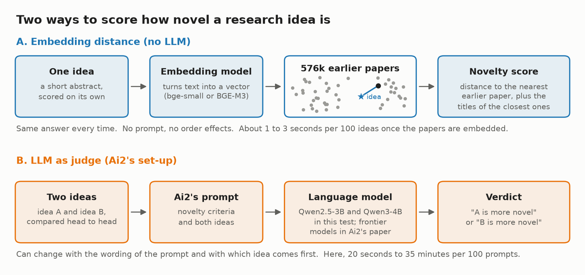
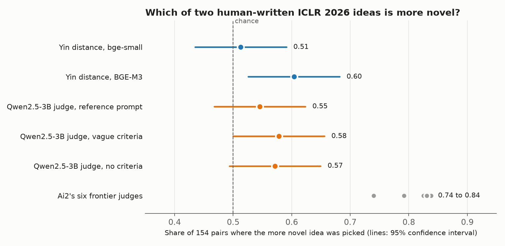
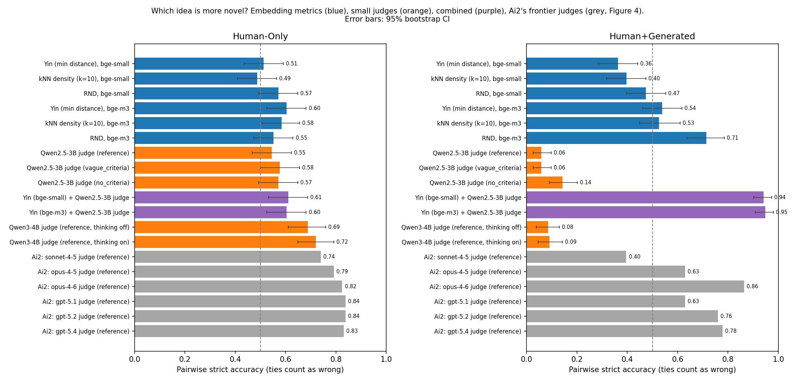

[Code and data on GitHub](https://github.com/CJosh88/ML/tree/main/experiments/2026-11-novelty-embedding-baseline)

::: {.callout-note appearance="simple"}
## TL;DR

- **The question:** with no LLM at all, can distance to prior work tell which of two research ideas is more novel, on the same items Ai2 used to test LLM judges?
- **Roughly as well as a small judge.** With the BGE-M3 embedding model, the simplest distance score picked the more novel idea in 60% of 154 human-written pairs (95% confidence interval 53% to 68%). A 3B LLM judge using Ai2's prompts scored 55% to 58%, and the two are not significantly different. Both cheap methods sit roughly halfway between chance and the frontier.
- **Nowhere near the frontier.** Ai2's six frontier judges scored 74% to 84% on the same pairs.
- **The embedding model matters as much as the metric.** With the smaller bge-small model, every distance score was at chance.
- **The small judge's weakness was order, not wording.** Its verdict flipped on 87% of pairs when the two ideas swapped places.
- **Mixed human and LLM-written pairs mostly measure who wrote the idea**, for distance and judges alike.
:::

## Why I ran this

Research agents can now generate ideas faster than anyone can read them, so something has to filter them, and novelty is one of the first filters people reach for. The usual tool is an LLM judge: give a model the idea and ask whether it is new.

In October 2026, Ai2 published [Old Ideas, Novel Problems](https://arxiv.org/abs/2610.02022), a benchmark built to test exactly those judges. Its findings were not encouraging. Rewording the prompt moved pairwise accuracy by more than 50 points for some judges, giving the judge related papers barely helped, and two purpose-built novelty systems lost to a plainly prompted model. The study cost about $15,000 in API calls, and every condition in it is an LLM.

There is an older and much cheaper way to score novelty: embed the idea and measure how far it sits from everything published before. Liu and Zhai's [axiomatic benchmark](https://arxiv.org/abs/2604.15145) (2026) found the simplest version of this, Yin et al.'s minimum distance, the strongest of ten novelty systems on their tests, but on different data.

Before building anything, I read Ai2's paper looking for an embedding baseline. There isn't one: no similarity score, no nearest-neighbour baseline, nothing that scores novelty without an LLM. So the question was open: on Ai2's own items, how close does plain distance get to an LLM judge? The metrics aren't new. The comparison is.

## The benchmark

Ai2 mined ICLR 2026 reviews for comments that explicitly praised or faulted a submission's originality. From the top and bottom rating deciles of each research area, that gave 154 submissions reviewers called original and 145 they called unoriginal. Ai2 rewrote each abstract with Claude Opus 4.6 to strip out results, so that a judge sees the idea rather than the numbers.

The benchmark comes in two formats:

- **Pairwise:** two ideas, one praised and one faulted. Which is more novel? Scored by accuracy, where chance is 50%.
- **Pointwise:** one idea. Does it clear ICLR's bar for novelty? Scored by macro-F1.

And two splits. **Human-Only** pairs human ideas with human ideas, and it is the one I treat as the main result. **Human+Generated** pairs each praised human idea with one written by a plainly prompted Claude Sonnet 4.5. Ai2 describes those labels as weaker, and as you'll see, that split turned out to measure something else entirely.

## Two ways to score novelty

**Embedding distance** scores one idea at a time. An embedding model turns the idea's abstract into a vector, and the score depends on how close that vector is to the nearest of 576,000 earlier papers. I tested three versions, from simplest to most involved:

- **Yin:** one minus the cosine similarity to the single nearest paper (Yin et al., 2023, *PLOS ONE*). Far from everything means novel.
- **kNN density:** the same, averaged over the 10 nearest papers, so one lucky near-miss counts for less.
- **RND:** relative neighbour density ([Wang et al., 2025](https://arxiv.org/abs/2503.01508)). It compares how crowded the idea's neighbourhood is with how crowded its neighbours' own neighbourhoods are, which is meant to correct for some fields simply being denser than others.

**An LLM judge** reads both ideas inside Ai2's prompt, which spells out what counts as novel, and says which one is more novel. It brings its own knowledge of the field from training, but not a list of papers it can point to.

The practical differences matter as much as accuracy. Distance gives the same answer every time and comes with evidence: the titles of the closest papers, which anyone can check. A judge compares the two ideas directly, which is closer to what a reviewer does, but it can change its answer with the wording of the prompt or with which idea it reads first.

## Setup

| | |
|---|---|
| **Benchmark** | [allenai/novelty-judge-bench](https://huggingface.co/datasets/allenai/novelty-judge-bench) (ODC-BY), pinned to one revision: 154 pairs per split, plus single-idea versions |
| **Prior work** | 576k ML papers with abstracts from the [Papers with Code archive](https://huggingface.co/datasets/pwc-archive/papers-with-abstracts) (CC BY-SA 4.0), which stops in July 2025, two months before the ICLR 2026 deadline |
| **Embedding models** | bge-small-en-v1.5 (33M parameters, 2023) and BGE-M3 (568M parameters, 2024, the model Liu and Zhai used) |
| **Judge** | Qwen2.5-3B-Instruct (September 2024), on Ai2's reference prompt and two of its prompt variants: vague criteria and no criteria. The prompts are loaded from [Ai2's own code](https://github.com/allenai/novelty-eval) at a pinned commit. |
| **Metrics** | Ai2's metrics, plus 95% bootstrap confidence intervals, exact McNemar tests between conditions on the same pairs, and AUROC |
| **Hardware** | One free Colab T4 GPU. A first run takes about two hours, most of it embedding the corpus. |

Every model was released before the ICLR 2026 submissions existed, so none of them can have seen the papers or the reviews.

### The leakage filter

Many ICLR submissions were on arXiv months before the deadline. A naive search would find each idea's own preprint, measure a distance of nearly zero, and call it unoriginal. So any paper matching an idea's OpenReview ID or title, or with cosine similarity of 0.95 or more, was dropped from that idea's neighbours and logged.

That removed 31 matching preprints by ID or title, and 24 near-copies by similarity. Most near-copies were obviously the same work under a new title: "Image Quality Assessment for Embodied AI" matched "Perceptual Quality Assessment for Embodied AI" at 0.999. A few at the threshold were genuinely different earlier papers, such as the benchmark MT-Eval, matched to "LLMs Get Lost In Multi-Turn Conversation" at 0.951. Any fixed threshold trades one error for the other, and this one leans towards removing too much rather than too little.

### The judge, run cheaply

Ai2's judges reason at length and pool three samples per verdict. I read the verdict straight from the model's probabilities for "0" and "1" after an empty reasoning block, which is fast and deterministic. I also ran every pair in both orders and averaged the two probabilities, for a reason that becomes clear below.

## Results: which of two ideas is more novel?

With BGE-M3, Yin's distance picked the more novel idea 60% of the time. The 3B judge scored 55% to 58% across the three prompts. On the pairs where one was right and the other wrong, neither won significantly (McNemar p = 0.33 to 0.71), and the judge itself was not significantly above chance with any prompt.

Ai2's frontier judges (Claude Sonnet 4.5, Opus 4.5 and 4.6, GPT-5.1, 5.2 and 5.4) scored 74% to 84%. That gap is the clearest result here: both cheap methods sit roughly halfway between chance and the frontier.

All three distance metrics on the Human-Only pairs:

| Metric | bge-small | BGE-M3 |
|---|---|---|
| Yin (nearest paper) | 51% | **60%** |
| kNN density (10 nearest) | 49% | 58% |
| RND | 57% | 55% |

With BGE-M3, the ranking matches Liu and Zhai's: the simplest metric wins. Combining BGE-M3 distance with the judge in a cross-validated regression added nothing (60% either way).

A caveat on that 60%: I tested six embedding conditions per split, and after a Bonferroni correction for that (p below 0.008), none clears the bar. The uncorrected p-value is 0.012. I'd call it suggestive, not shown.

## Results: scoring one idea at a time

On single ideas, the judge did better than distance.

| Condition | CV macro-F1 | AUROC |
|---|---|---|
| Yin, bge-small | 0.55 | 0.54 |
| Yin, BGE-M3 | 0.58 | 0.57 |
| RND, bge-small | 0.56 | 0.59 |
| 3B judge, reference prompt | 0.56 | 0.64 |
| 3B judge, no criteria | 0.62 | 0.68 |
| Ai2's frontier judges, reference prompt (yes/no verdicts) | 0.61 to 0.81 | |

Distance has no natural cut-off, so each score gets a threshold chosen by cross-validation (CV macro-F1). AUROC measures how well a score separates the two groups at any threshold.

One oddity: the 3B judge said "novel" to almost every idea. Its probability of "novel" sat close to 1.0 for nearly all of them, so with Ai2's plain 50% cut-off its F1 was only 0.35 to 0.40. The signal is there, as the AUROC shows, but only in tiny differences near the top of the scale.

## The embedding model matters as much as the metric

I added BGE-M3 after the first run, because I wanted to know whether a weak result was down to a small embedding model. It was, partly. With bge-small, all three distance scores were at chance on Human-Only. BGE-M3 got 28 pairs right that bge-small got wrong, against 14 the other way (p = 0.044).

More striking was how much the two models disagree about what counts as nearby. Their Yin scores correlate at only 0.64, and they picked the same nearest paper for just 19% of ideas.

So a distance score isn't free of configuration choices. For a judge, the prompt is the setting that can quietly change the answer. For distance, it's the embedding model.

## The judge's weakness was order, not wording

Ai2's headline finding was prompt sensitivity, so I ran the judge on three of their prompts. Wording barely moved it:

| Judge | Spread across the three prompts, Human-Only | Spread, Human+Generated |
|---|---|---|
| Qwen2.5-3B (this test) | 3 points | 8 points |
| Ai2's six frontier judges | 1 to 10 points | 6 to 21 points |

On these three prompts, the small judge is about as stable as the frontier ones. Ai2's swings of more than 50 points come from other prompt variants that I didn't run.

Order was the real problem. When I swapped which idea came first, the judge's verdict flipped on 87% of Human-Only pairs with the reference prompt, and on 53% to 61% with the other two. Most of the time it was picking a position, not an idea. Averaging both orders cancels that out, which is why I ran every pair twice. If you use a small model as a pairwise judge, I'd treat order-swapping as mandatory.

## What distance gets right, and what it can't see

Two pairs from the results show both sides.

**Where distance was right and the judge wrong.** "LLM Pretraining with Continuous Concepts" (praised by reviewers) against "InfiMed-Foundation", a medical multimodal model (faulted). The nearest earlier paper to InfiMed-Foundation was "Infi-Med: Low-Resource Medical MLLMs with Robust Reasoning Evaluation", which appears to be earlier work from the same project. Distance saw that closeness straight away, and the judge leaned the other way.

**Where both were wrong.** "Lipschitz Bandits with Stochastic Delayed Feedback" (praised) sat very close to "Delayed Feedback in Generalised Linear Bandits Revisited", so distance rated it unoriginal. But a new combination of known ingredients can be exactly what reviewers call novel, which is close to the point of Ai2's title. Distance can tell you an idea is near existing work. It can't tell you whether the step it takes is a meaningful one.

## Mixed human and LLM pairs measure authorship

On Human+Generated, every pair sets a praised human idea against one written by Claude Sonnet 4.5. The numbers on the right of the chart look wild, and none of them should be read as novelty accuracy:

- **The 3B judge preferred the LLM-written idea 94% of the time.** Ai2's own Sonnet 4.5 judge, the model that wrote those ideas, picked the human idea in only 40% of pairs.
- **bge-small distance rated the LLM-written idea as more novel in 64% of pairs**, which put it below chance.
- **BGE-M3's RND scored 71%**, which looks impressive until you see it reaches only 55% when both ideas are human. It ranked the LLM-written idea lower in 73% of pairs, so it is most likely picking up LLM writing rather than novelty.
- **The combined score reached 95%**, because the regression learned to flip a judge that was reliably wrong. That is not the two scores agreeing.

If you want to compare human and LLM-generated ideas for novelty, this is the warning: every method here reacts to who wrote the text.

## Is any score measuring quality instead?

The two groups come from opposite ends of the rating distribution, so a score could separate them by tracking how good a paper is rather than how new. Within each group, every idea carries the same novelty label but ratings still vary, so a strong link to rating inside a group would point to quality.

There wasn't one. No score correlated with reviewer rating beyond 0.14 within either group, and none significantly. The ratings within each group span a narrow range, which limits how much this check can detect, but nothing suggests any score is quietly measuring quality.

## Cost

| | Time per 100 ideas on a T4 | Notes |
|---|---|---|
| Distance, bge-small | about 1 second | after a one-off embedding of the corpus |
| Distance, BGE-M3 | about 3 seconds | after a one-off embedding of the corpus |
| Qwen2.5-3B judge | 20 to 40 seconds | depending on prompt length |
| Ai2's frontier judges | API fees | about $15,000 for Ai2's whole study |

The corpus embedding is the expensive part of distance, and it is paid once. After that, scoring a new idea is a single embedding and a nearest-neighbour search.

## When I'd use distance, and when I wouldn't

**I'd use it as a cheap first pass.** It is repeatable and fast, and the nearest titles give a reviewer or a stronger judge something concrete to check. That makes it good for flagging ideas that sit very close to existing work, and for supplying related papers to a better judge.

**I wouldn't use it to rank ideas on its own.** Frontier judges are 14 to 24 points ahead. I also wouldn't use it to compare human and LLM-written ideas, or trust one embedding model's verdict without trying a second.

**I wouldn't use a small model as a pairwise judge without swapping the order.** Its verdict depended more on position than on content.

## Limitations

- **154 pairs per split.** Each accuracy has a confidence interval of about 8 points either side, and with this many conditions, some results below p = 0.05 are expected by chance.
- **The judge is small and didn't reason.** Reading probabilities after an empty reasoning block understates what Qwen2.5-3B can do. It is a cheap baseline, not a rerun of Ai2's judges.
- **One corpus snapshot.** Papers with Code ends in July 2025 and leans towards papers with code and benchmarks, so recent or theory-heavy prior work is missing, which makes some ideas look more novel than they are.
- **The leakage filter is a blunt tool.** A heavily rewritten preprint below 0.95 still counts as prior work against its own idea, and a few genuinely earlier papers above it were removed.
- **Rewritten ideas, raw corpus.** The benchmark ideas are abstracts Ai2 rewrote with Claude Opus 4.6 to strip out results, while the corpus holds original abstracts. For the 31 ideas whose original is in the corpus, the rewrite moved each text far less than the distance to its nearest other paper: median cosine to its own original was 0.99 with bge-small and 0.98 with BGE-M3, against 0.91 and 0.77 to the nearest other paper. A shift shared by all ideas cancels out in pairs, but the part that varies from idea to idea adds noise unrelated to novelty, and may be part of why distance tops out around 60%. BGE-M3 also put 8 of those 31 ideas below 0.95 from their own original, so its cosine threshold alone would have missed them; the ID and title check caught them. On Human+Generated, both sides are LLM text (Opus rewrites of real abstracts against ideas Sonnet 4.5 wrote from scratch), so that split's effect is best read as real-paper ideas against generated ones, whether through content or style.
- **Labels mined from reviews** mix novelty with quality, and the frontier numbers are read off Ai2's figure, not rerun.

## What I'd test next

- **A frontier judge given the nearest papers that distance finds**, so it judges with evidence rather than memory. Ai2 found that related papers helped their judges little; this would test whether the nearest neighbours from a large corpus do any better.
- **Ai2's other prompt variants** on the small judge, to see whether it shows the same large swings.
- **A different leakage threshold**, such as 0.96, to see how sensitive the distance results are to it.

## Try it yourself

The notebook runs top to bottom on a free Colab GPU, with the corpus embeddings and judge outputs cached on Google Drive so a disconnect doesn't lose work. No API keys are needed.

Thanks to Ai2 for the benchmark and for publishing their prompts and code, to the Papers with Code archive maintainers, and to BAAI and the Qwen team for the models.

[Notebook on Colab](https://colab.research.google.com/github/CJosh88/ML/blob/main/experiments/2026-11-novelty-embedding-baseline/notebook.ipynb) · [Code and results on GitHub](https://github.com/CJosh88/ML/tree/main/experiments/2026-11-novelty-embedding-baseline)
